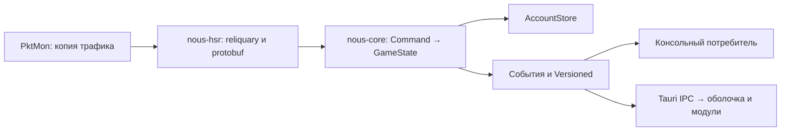

# SDK

SDK работает без окна, WebView и Tauri. Это два локальных Rust-крейта в корневом Cargo workspace: `nous-core` и `nous-hsr`. Третий крейт, `nous-veritas`, — отдельный SDK модуля Veritas и к данным аккаунта не относится. Текущая версия публичного API — `nous_core::API_VERSION = 1`; версия файлов аккаунта независимо остаётся `format: 2`.

## Границы

| Крейт | Ответственность | Зависимости |
|---|---|---|
| `nous-core` | Модели аккаунта, предметные команды `Command`, `GameState`, ревизии, события, `Client`, контракт хранилища и файловая реализация | serde, serde_json, log; без Tauri, protobuf и захвата |
| `nous-hsr` | Пассивный PktMon, reliquary, преобразование protobuf в `Command`, записи входа, импорт истории прыжков, публичный `Sdk` | ядро, Windows-захват и протокол; без Tauri |
| `app/src-tauri` | IPC, пересылка событий SDK, окно, трей, запуск игры, автообновление и существующая опция Veritas | SDK и Tauri |



`decode(&GameCommand)` в HSR-адаптере возвращает обычную структуру `nous_core::Command`. Один пакет, затрагивающий несколько разделов, обрабатывается целиком под одним lock и получает одну ревизию. Правила слияния инвентаря, хранения мира и ограничения истории находятся в ядре; расшифровка и чтение полей протокола — в адаптере. Неизвестный или неразбираемый пакет, как прежде, не создаёт изменений. Ошибки захвата и хранилища диагностируются отдельно.

Правила, которые защищают сохранённые данные:

- **Отказной ответ сервера ничего не меняет.** Ответ с `retcode != 0` приходит с пустыми полями; адаптер его отбрасывает (макрос `rsp!`), иначе отказ входа создавал аккаунт 0, а отказ `GetBagScRsp` опустошал инвентарь.
- **Повтор без изменений — не изменение.** Игра повторяет состояние объектов сцены, карту и сундуки; ревизия растёт и событие уходит, только если что-то действительно отличается.
- **`world-changed` несёт только изменившиеся этажи**: `{ planeId, floorId, entryId, player, floors: { <этаж>: { openedChests, openedAt, props } } }`. Подписчик подставляет эти этажи в мир, прочитанный раньше (`mergeWorld` в `app/src/lib/world-patch.ts`). Весь мир — десятки тысяч объектов и сотни килобайт.
- **Последняя позиция доходит.** `player-moved` выходит не чаще раза в 100 мс; позиция, пришедшая внутри этого интервала, отправляется по таймеру, даже если игрок больше не двигается.
- **Числа в отчёте боя конечны.** `NaN` и бесконечность заменяются нулём перед сохранением: JSON записал бы `null`, и файл аккаунта перестал бы читаться. Уже записанный `null` читается как 0.
- **Испорченный `accounts/current` не мешает запуску**: берётся самый свежий файл аккаунта.
- **Падение потока захвата видно**: статус `error` и событие `sdk-error`, а не «подключено» при мёртвом захвате.

## Использование без приложения

```toml
[dependencies]
nous-hsr = { path = "<checkout>/crates/nous-hsr" }
```

```rust
use nous_hsr::Sdk;

fn main() -> Result<(), String> {
    let sdk = Sdk::new(None)?; // без записи аккаунтов и записей входа на диск
    let events = sdk.subscribe(); // сначала подписка, затем снимок
    let initial = sdk.read(); // Versioned<Account>
    println!("revision {}", initial.revision);
    sdk.start_capture()?;
    // events.recv() / recv_timeout() / try_recv(): Event { name, payload }
    println!("{:?}", sdk.status());
    sdk.stop_capture()?;
    Ok(())
}
```

Полный консольный потребитель: `examples/events.rs`. Из корня:

```powershell
cargo run -p nous-hsr --example events
cargo run -p nous-hsr --example events -- --smoke
```

Обычный запуск печатает события и ждёт Enter. `--smoke` проверяет создание, подписку, снимок, запуск и остановку без ожидания входа. Пример всегда использует временное состояние и не обращается к `%APPDATA%\com.nous.companion`.

Захват предназначен для Windows. PktMon требует администратора; без повышения `start_capture()` сообщает статус `needs_admin`, при этом состояние и подписки доступны. Запуск и остановка повторяемы; остановка отменяет ожидание даже при отсутствии пакетов, дожидается потока и сохраняет изменения. `Drop` также останавливает захват. Для гарантированного получения ошибки последней записи вызывайте `stop_capture()` или `client().flush()` явно.

## Публичные точки входа

| API | Назначение |
|---|---|
| `Sdk::new(Option<PathBuf>)` | Создать экземпляр с файловым хранилищем; путь — корень данных, внутри `accounts/` и `recordings/`. `None` отключает запись |
| `Sdk::with_store(Arc<dyn AccountStore>, recordings)` | Подменить хранилище; каталог записей входа задаётся отдельно, `None` отключает запись входов |
| `start_capture()` / `stop_capture()` | Жизненный цикл пассивного захвата, `Result<(), String>` |
| `status()` | Текущий `SnifferStatus`; добавлен `stopped` |
| `read()` | Согласованный `Versioned<Account>` |
| `subscribe()` | Независимый `std::sync::mpsc::Receiver<Event>` |
| `client()` | Ядро: `read`, `query`, `handle`, `import_pulls`, `flush`, `subscribe` |
| `Client::new(store)` / `Client::with_store(store)` | Только ядро, без захвата и протокола |
| `GameState::handle(&Command)` | Последовательная предметная обработка; ошибки смены аккаунта возвращаются вызывающему |

`Client` клонируется и безопасно используется из нескольких потоков. `query` выполняет короткую проекцию под lock и возвращает её с той же ревизией; не вызывайте из проекции методы того же клиента. `handle` публикует события в порядке команд. Подписку нужно обслуживать или уничтожить: канал неограниченный, отставший потребитель накапливает события. Сброс аккаунта означает необходимость перечитать все разделы.

События данных сохраняют прежние имена и JSON `{ revision, data }`, см. [[API данных игры]]. `sniffer-status` остаётся невёрсионированным статусом захвата. Новое диагностическое событие `sdk-error` содержит `{ message }`. Синхронные ошибки возвращаются через `Result`; ошибка фонового сохранения также публикуется, грязное состояние остаётся для повторной записи. Неуспешное сохранение перед сменой UID не разрешает переключить аккаунт.

## Хранилище и запись

`AccountStore: Send + Sync` задаёт `load_current`, `load_or_new`, `save` и необязательный `append_log`. Тесты публичного API подменяют его памятью и управляемыми ошибками. Реализации должны сохранять исходник нечитаемого файла и обеспечивать последовательную запись. Для одного каталога используйте один экземпляр SDK: межпроцессной блокировки файлов нет.

`FileStore` сохраняет существующую раскладку, миграцию 1 → 2 и атомарную замену файла. Нечитаемый исходник откладывается с уникальной временной меткой; если сохранить исходник не удалось, ошибка прерывает загрузку, а не разрешает перезапись. SDK никогда сам не выбирает каталог пользовательского приложения: его явно передаёт потребитель.

Поток сохранения объединяет изменения раз в 1,5 с. Снимок копируется под lock состояния, запись идёт без этого lock; обычная команда и чтение продолжаются. Отдельный writer lock сохраняет порядок записей и барьер перед сменой аккаунта. Изменение во время записи остаётся грязным до следующей записи. Журнал реликвий тоже отложен; при ошибке журнал повторяется с гарантией как минимум одной записи, поэтому диагностические строки могут дублироваться. При переключении аккаунта и явном flush ожидается завершение предыдущей записи.

## Проверки

`cargo test --workspace --all-targets` из корня проверяет ядро, адаптер, оболочку, пример и публичные API. `cargo test -p nous-core` позволяет проверить ядро отдельно, без компиляции Windows-захвата и protobuf. `npm run test:data` в `app/` запускает replay в `nous-hsr`: через `decode` → `GameState::handle` → временный store.

Связано: [[Обзор архитектуры]], [[Данные аккаунта]], [[Сниффер]], [[SDK и модули — отчёт]].
