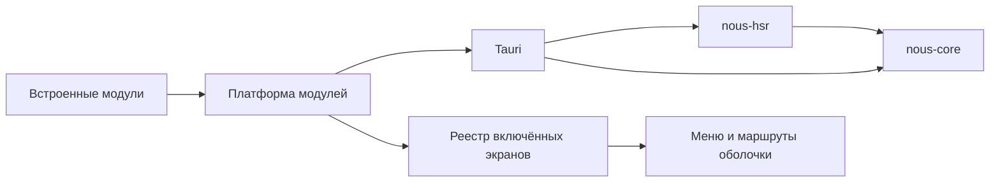

# Обзор архитектуры

Nous состоит из независимого Rust SDK и приложения-оболочки со встроенными модулями. SDK может использовать консольная программа без Tauri. Модуль может работать в фоне и не иметь ни одного экрана; экран — одна из возможностей модуля.

| Слой | Расположение | Ответственность |
|---|---|---|
| Ядро SDK | `crates/nous-core/` | Предметные модели и команды, GameState, аккаунты, ревизии, события, подменяемое хранилище |
| Адаптер HSR | `crates/nous-hsr/` | Пассивный захват, reliquary/protobuf → предметные команды, история прыжков |
| Tauri-адаптер | `app/src-tauri/src/ipc.rs`, `lib.rs`, `module_config.rs` | Команды чтения и передача событий SDK без изменения IPC-контракта |
| Сервисы оболочки | `app/src-tauri/src/launch.rs`, `sniffer.rs` | Окно, трей, запуск игры и автозапуск, перезапуск с повышением |
| Платформа модулей | `app/src/features/registry.ts`, `ModuleProvider.tsx`, `module-runtime.ts`, `types.ts` | Описания, выбор, жизненный цикл, сервисы и настройки модулей |
| Оболочка | `app/src/App.tsx`, `components/` | Окно, профиль, фон, меню, маршрутизация и обязательные настройки |
| Встроенные модули | `app/modules/<id>/` | Экраны, разделы настроек, фоновая работа и своя Rust-часть ([[Модули]]) |
| SDK Veritas | `crates/nous-veritas/` | События боя от плагина Veritas, модели и экспорт; нужен только модулю `veritas` |
| Дизайн-система | `app/src/ui/` | Токены и компоненты |

Ядро не импортирует Tauri, AppHandle, reliquary и protobuf. Адаптер HSR не зависит от оболочки. Tauri не содержит второй копии предметной обработки. Модуль импортирует `ui/`, `lib/` и свои файлы; другие модули не импортирует. Общая логика уходит в `lib/`, общие визуальные компоненты — в `ui/`.

Оболочка получает один набор активных экранов из платформы. Отключение удаляет и меню, и маршрут, останавливает фоновый lifecycle модуля. Последний потребитель HSR отключает захват. Настройки — обязательный экран оболочки; если выбранная вкладка исчезла, маршрут ведёт на существующий экран, а при пустом наборе модулей — в настройки. Veritas — модуль `app/modules/veritas` со своей Rust-частью; его согласие и логика при переносе не менялись.

Экран каждого модуля — отдельный чанк, который загружается при первом открытии вкладки; в стартовом файле остаются оболочка и лёгкие точки входа модулей.

Работают вкладки «Обзор», «Персонажи», «Инвентарь» и «Карта». Что из целевой архитектуры ещё не сделано — в [[Ревью проекта — 2026-11-12]].

Связано: [[SDK]], [[Структура проекта]], [[Регистрация экранов]], [[SDK и модули — отчёт]].
