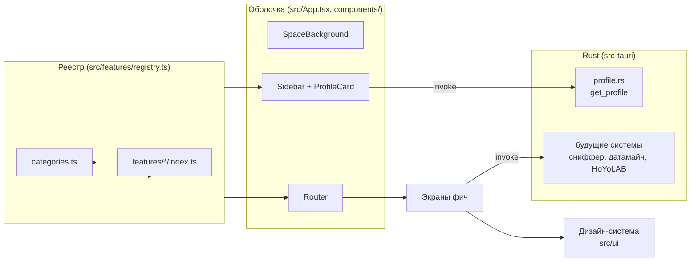

# Обзор архитектуры

Nous устроен как **оболочка** (shell) и **фичи**. Оболочка не знает, какие экраны в ней живут: она берёт их из реестра и рисует меню и маршруты. Фича — самостоятельный экран со своей логикой, который при необходимости ходит в свою систему на стороне Rust.

## Слои

| Слой | Где | За что отвечает |
|---|---|---|
| Дизайн-система | `src/ui/` | Токены и компоненты. Единственный источник внешнего вида, см. [[Дизайн-система]] |
| Оболочка | `src/App.tsx`, `src/components/`, `src/shell.css` | Окно, фон, боковое меню, профиль, маршрутизация |
| Реестр фич | `src/features/registry.ts`, `categories.ts`, `types.ts` | Собирает экраны и разделы меню, см. [[Регистрация экранов]] |
| Фичи | `src/features/<id>/` | Конкретные экраны |
| Общая логика фронта | `src/lib/` | Профиль, форматирование чисел, иконки |
| Бэкенд | `src-tauri/src/` | Системы на Rust и команды Tauri, см. [[Rust и команды Tauri]] |

## Правила зависимостей

- Фича может импортировать `ui/`, `lib/` и свои файлы. **Фича не импортирует другую фичу** и не лезет в `components/` оболочки.
- `ui/` ничего не знает про фичи и оболочку.
- Оболочка знает про фичи только через реестр.
- Общий для нескольких фич код уходит в `lib/`, а если это элемент интерфейса, то в `ui/` как новый компонент (см. [[Компоненты#Как добавить компонент]]).

> [!warning] Почему так строго
> Тогда фичу можно добавить или удалить одной папкой, ничего не сломав. Это главный смысл оболочки.

## Связанные заметки

- [[Структура проекта]]
- [[Регистрация экранов]]
- [[Rust и команды Tauri]]
