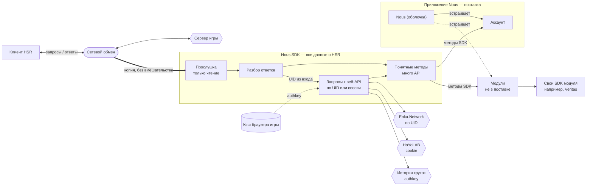

# Целевая архитектура

Согласованное видение устройства Nous, собранное по шагам. Интерактивная версия с легендой: [[Схемы/Целевая архитектура.html]] (холст: https://claude.ai/artifact/3NXH4haUeKdtgidqtJZQps). Это цель, а не описание текущего кода: как устроено сейчас — [[Обзор архитектуры]].

## Шаги

1. **Nous SDK — библиотека данных HSR.** Через неё идут все данные о Honkai: Star Rail; всё остальное получает данные игры только через неё.
2. **Откуда SDK берёт данные.** Клиент обменивается с сервером запросами и ответами; SDK этот обмен только слушает (копия трафика, ничего не отправляет, в игру не вмешивается) и отдаёт собранное набором понятных методов — много отдельных API.
3. **Второй источник — веб-API по UID или сессии.** По UID публично — витрина игрока (Enka.Network). С ключом сессии: authkey из кэша браузера игры — официальная история круток, cookie HoYoLAB — боевая хроника и заметки. UID берётся из увиденного входа.
4. **Приложение: в поставке только аккаунт.** Nous — оболочка; из коробки только аккаунт (вход, профиль). Всё остальное, даже Veritas, — модули, подключаемые отдельно.
5. **Модули цепляются к SDK сами.** Оболочка только встраивает экраны; аккаунт и модули берут данные напрямую из методов SDK. Модуль может приносить свои SDK, не связанные с Nous (например, Veritas).

## Отклонено

- **Имитация клиента игры** (свои запросы к серверу или подмешивание пакетов в соединение игры): требует обхода защиты протокола, заметно серверу, нарушает Пользовательское соглашение — высокий риск бана. SDK остаётся пассивным.

## Открытые вопросы

- Как модули попадают к пользователю (встроены и выключены, скачиваются, каталог в Nous).
- Ограничивает ли Nous модули с собственными SDK (объявление возможностей: файлы в папке игры, сеть) и предупреждает ли при установке.
- Вход в HoYoLAB для cookie — отдельный шаг пользователя.

## Связанные заметки

- [[Обзор архитектуры]]
- [[API данных игры]]
- [[Ревью архитектуры — 2026-11-03]]
